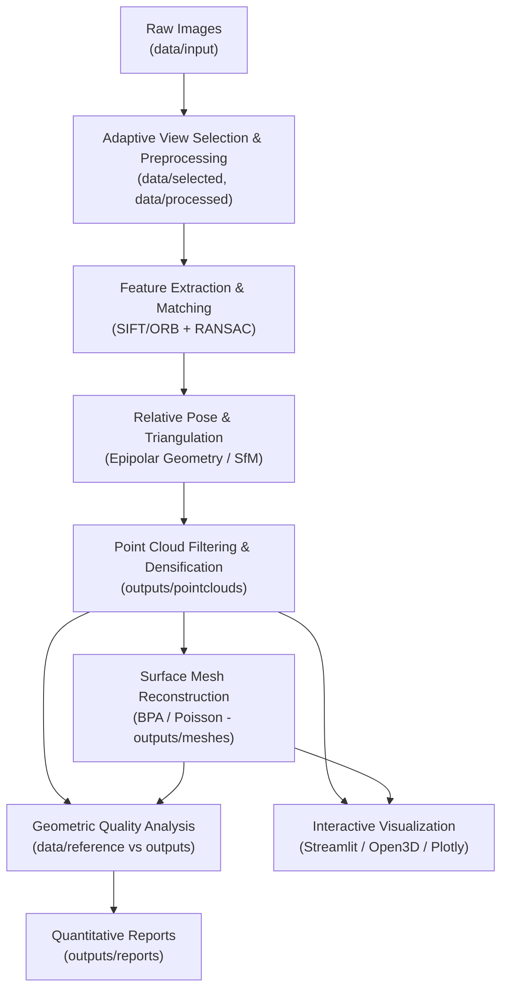

# Adaptive Multi-View 3D Object Reconstruction and Geometric Analysis

A research-oriented Computer Vision project for multi-view 3D object reconstruction, surface estimation, and geometric quality evaluation using CPU-compatible libraries in Python 3.11.

---

## 1. Project Overview

This project investigates adaptive multi-view 3D reconstruction from uncalibrated or partially calibrated image sequences. The primary objective is to develop a modular, end-to-end pipeline that takes a collection of 2D images of an object, adaptively selects optimal viewpoints, reconstructs dense 3D representations (point clouds and surface meshes), and performs rigorous geometric analysis and validation against reference measurements or ground-truth geometries.

### Key Objectives
- **Adaptive View Selection**: Filter redundant or degraded frames (e.g., blur, poor baseline angle) to optimize reconstruction fidelity.
- **Sparse-to-Dense Reconstruction**: Feature detection and matching (SIFT/ORB), epipolar geometry estimation, triangulation, and point cloud densification.
- **Surface Mesh Generation**: Transform point clouds into watertight or semi-dense surface meshes using classical meshing algorithms (e.g., Poisson Reconstruction, Ball Pivoting).
- **Geometric Analysis**: Compute quantitative quality metrics such as point cloud density, Chamfer distance, Hausdorff distance, surface area, and bounding dimensions.
- **Interactive Visualization**: Provide exploratory visualization using Streamlit, Plotly, and Open3D.

---

## 2. Technology Stack

- **Language & Runtime**: Python 3.11 (Windows 64-bit, CPU-optimized)
- **Computer Vision & Image Processing**: `opencv-contrib-python`, `scikit-image`, `Pillow`
- **3D Geometry & Mesh Processing**: `open3d`
- **Numerical & Scientific Computation**: `numpy`, `scipy`
- **Data Handling**: `pandas`, `tqdm`
- **Visualization & UI**: `streamlit`, `plotly`

---

## 3. Directory Structure

```text
CV_Project/
├── .venv/                      # Python virtual environment (ignored by git)
├── .gitignore                  # Git ignore rules for CV data, outputs, and artifacts
├── check_environment.py        # Environment diagnostic and verification script
├── requirements.txt            # Dependency specification
├── README.md                   # Project documentation and architectural overview
│
├── config/                     # Centralized project configuration
│   ├── __init__.py
│   └── settings.py             # Global filesystem paths and baseline parameters
│
├── data/                       # Dataset directories
│   ├── input/                  # Raw input multi-view image sets
│   ├── selected/               # Adaptively filtered/selected keyframe subsets
│   ├── reference/              # Reference ground truth data (CAD, benchmark meshes)
│   └── processed/              # Preprocessed intermediate data (rectified, masks)
│
├── modules/                    # Core modular algorithm implementations
│   └── __init__.py             # (To contain: preprocessing, matching, sfm, meshing, analysis)
│
├── visualization/              # Visualization utilities and dashboards
│   └── __init__.py             # (To contain: Streamlit app, Open3D/Plotly visualizers)
│
├── experiments/                # Research experiments and ablation scripts
│   └── __init__.py             # Benchmarking scripts, parameter sweeps, and validation runs
│
├── outputs/                    # Output artifacts generated by pipeline stages
│   ├── pointclouds/            # Reconstructed point cloud files (.ply, .pcd)
│   ├── meshes/                 # Reconstructed 3D surface meshes (.ply, .obj)
│   └── reports/                # Quantitative evaluation metrics, logs, and plots (.csv, .json)
│
└── tests/                      # Unit and integration tests
    └── __init__.py
```

---

## 4. Planned Pipeline & Workflow



### Stage 1: Data Acquisition & Preprocessing (`data/input/`, `modules/`)
- Ingestion of multi-view photographs.
- Blur/sharpness assessment (Laplacian variance), contrast adjustment, and optional background segmentation.

### Stage 2: Adaptive View Selection (`data/selected/`, `modules/`)
- Frame pruning based on visual overlap, baseline distance, and feature richness to avoid redundant computation and degenerate baseline angles.

### Stage 3: Feature Matching & Pose Estimation (`modules/`)
- Robust keypoint extraction (SIFT/ORB) and descriptor matching with Lowe's ratio test.
- Fundamental and Essential matrix estimation via RANSAC.
- Camera trajectory and pose recovery.

### Stage 4: Point Cloud Generation & Filtering (`outputs/pointclouds/`)
- Triangulation of matched features to form a sparse point cloud.
- Dense estimation and statistical/radius outlier removal using Open3D.

### Stage 5: Mesh Generation (`outputs/meshes/`)
- Surface normal estimation and orientation.
- Surface reconstruction using Ball Pivoting Algorithm (BPA) or Screened Poisson Surface Reconstruction.

### Stage 6: Geometric Analysis & Evaluation (`data/reference/`, `outputs/reports/`)
- Comparison with ground truth references (if available): Chamfer Distance, Hausdorff Distance.
- Point cloud density, mesh manifoldness, watertightness, and surface area computation.

### Stage 7: Visualization (`visualization/`)
- Interactive 3D visualization dashboard using Streamlit and Plotly/Open3D.

---

## 5. Getting Started

### 1. Verify Environment
Ensure your Python virtual environment is activated and verify dependencies:

```powershell
# In PowerShell:
.\.venv\Scripts\Activate.ps1
python check_environment.py
```

### 2. Centralized Configuration
Import paths and settings directly in scripts to ensure consistency:

```python
from config.settings import (
    DATA_INPUT_DIR,
    OUTPUTS_POINTCLOUDS_DIR,
    DEFAULT_FEATURE_CONFIG,
    ensure_directories_exist
)

# Ensure required directories exist at runtime
ensure_directories_exist()
```

---

## 6. Team Collaboration Guidelines

- **Branching & Commits**: Use descriptive branch names (`feature/feature-matching`, `feature/mesh-reconstruction`).
- **Data Hygiene**: Do not commit large datasets, image files, or heavy mesh outputs to git; place them in `data/input/` and `outputs/` which are tracked with `.gitkeep` and ignored by `.gitignore`.
- **Modularity**: Place pure algorithmic logic inside `modules/`, keep experimentation scripts in `experiments/`, and place UI logic in `visualization/`.
